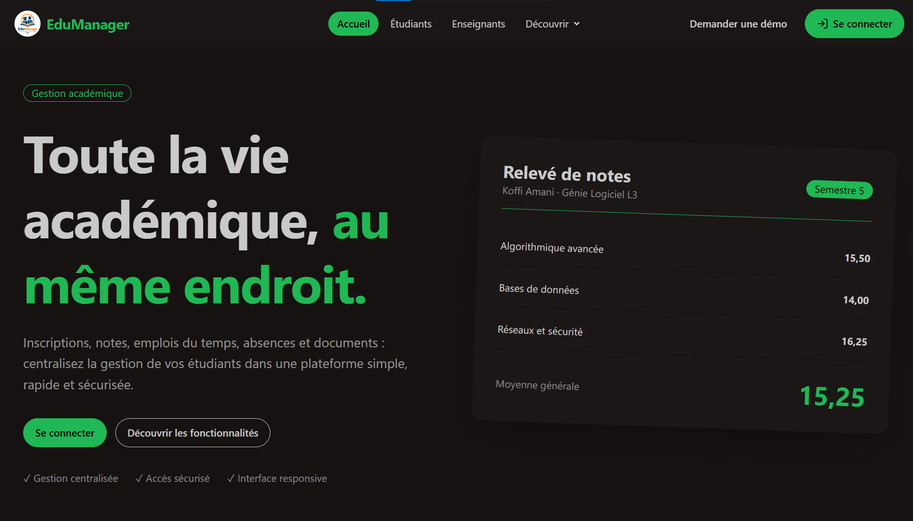

# Edu Manager

Plateforme web de gestion des étudiants, développée avec Laravel.



---

## À propos

Edu Manager centralise la gestion des étudiants d'un établissement : inscription, consultation de la liste, modification et suppression des fiches. L'objectif est de remplacer les suivis dispersés par une application unique, simple et claire.

Une partie dédiée aux enseignants est prévue dans une prochaine version.

## Fonctionnalités

- Inscription d'un étudiant
- Affichage de la liste des étudiants
- Modification et suppression d'une fiche étudiant
- Authentification des utilisateurs

À venir :

- Espace enseignants

## Stack technique

- [Laravel](https://laravel.com)
- PHP 8.2 ou supérieur
- Composer
- Node.js et npm (pour les assets front)
- Base de données : SQLite (par défaut) ou MySQL

## Installation en local

### 1. Prérequis

Vérifie que ces outils sont installés :

```bash
php -v
composer -V
node -v
npm -v
git --version
```

### 2. Cloner le dépôt

```bash
git clone https://github.com/YOYOMANU/EduManager.git
cd edu-manager
git checkout develop
```

### 3. Installer les dépendances

```bash
composer install
npm install
```

### 4. Configurer l'environnement

```bash
cp .env.example .env
php artisan key:generate
```

Ouvre ensuite le fichier `.env` et adapte la configuration de la base de données.

Avec SQLite (le plus simple), il suffit de créer le fichier de base :

```bash
touch database/database.sqlite
```

Avec MySQL, renseigne ces variables :

```env
DB_CONNECTION=mysql
DB_HOST=127.0.0.1
DB_PORT=3306
DB_DATABASE=edu_manager
DB_USERNAME=root
DB_PASSWORD=
```

### 5. Préparer la base de données

```bash
php artisan migrate
```

Pour insérer des données de démonstration (si des seeders existent) :

```bash
php artisan migrate --seed
```

### 6. Lancer l'application

Dans un premier terminal, le serveur Laravel :

```bash
php artisan serve
```

Dans un second terminal, la compilation des assets :

```bash
npm run dev
```

L'application est disponible sur [http://127.0.0.1:8000](http://127.0.0.1:8000).

## Lancer les tests

```bash
php artisan test
```

Pour lancer un fichier de test précis :

```bash
php artisan test tests/Feature/NomDuTest.php
```

## Workflow Git et contribution

Les branches `main` et `develop` sont protégées : aucun push direct n'est possible.

| Branche               | Rôle                                           |
| --------------------- | ---------------------------------------------- |
| `main`                | Version stable, prête pour la livraison        |
| `develop`             | Branche d'intégration commune à toute l'équipe |
| `feat/...`, `fix/...` | Branches personnelles, créées depuis `develop` |

Étapes pour contribuer :

1. Mettre à jour `develop` : `git checkout develop && git pull`
2. Créer sa branche : `git checkout -b feat/nom-de-la-fonctionnalite`
3. Coder, puis committer et pousser : `git push -u origin feat/nom-de-la-fonctionnalite`
4. Ouvrir une pull request **vers `develop`**
5. Obtenir **2 approbations** de la part de deux autres collaborateurs et résoudre tous les commentaires
6. Fusionner (Squash and merge)

Les versions de `develop` sont ensuite livrées sur `main` via une pull request soumise aux mêmes règles (Merge commit).

## Collaborateurs

Merci à toute l'équipe qui construit Edu Manager :

| Nom    | Rôle           | GitHub                               |
| ------ | -------------- | ------------------------------------ |
| Yoann  | Chef de projet | https://github.com/YOYOMANU          |
| Peggy  | Collaboratrice | https://github.com/Peggy06-n         |
| Janice | Collaboratrice | https://github.com/janicegnahore30   |
| Naomi  | Collaboratrice | https://github.com/naomitinan-source |
| Levi   | Collaborateur  | https://github.com/strausslevi9  |

## Licence

À définir.
